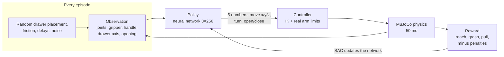

# drawerRL: teaching a Kinova Gen3 Lite to open a drawer with reinforcement learning

A robot arm learns, in simulation, to **find a drawer handle, grasp it and pull the drawer open**. The simulation is
built to match the real **Kinova Gen3 Lite** in our lab, so the trained policy can later be moved onto the real arm,
guided by a **ZED 2 camera**.

| | |
|---|---|
| Simulator | [MuJoCo](https://mujoco.org) 3.17 with the Gen3 Lite model and a cabinet built from real measurements |
| Learning | [Stable-Baselines3](https://stable-baselines3.readthedocs.io) **SAC** (Soft Actor-Critic) through a [Gymnasium](https://gymnasium.farama.org) environment |
| Task | Grasp the handle and open the drawer ≥ 15 cm, wherever the drawer is placed within ±15° and several cm of nominal |
| Sim-to-real | Arm speed and acceleration limits, gripper speed, robot mount and table measured on the real arm and put into the simulation |
| Included policy | `runs/sac_audit_fix_v7`, ready to watch |

---

## Quick start

**1. Install** (Python 3.10):

```bash
python3 -m venv .venv
.venv/bin/pip install -r requirements.txt
```

**2. Look at the world**: the arm, the lab table and the cabinet. You can drag the drawer with the mouse:

```bash
.venv/bin/python scripts/build_scene.py --view
```

**3. Watch a hand-written grasp-and-pull** (no AI), which shows the task is physically possible:

```bash
.venv/bin/python scripts/scripted_demo.py --viewer
```

**4. Watch the trained policy** open the drawer:

```bash
.venv/bin/python scripts/evaluate.py runs/sac_audit_fix_v7 --which best --viewer \
  --set task.randomization.placement_map=configs/placement_map_v6.yaml task.randomization.validate_reachability=false
```

**5. Train your own** (about 2 hours for 1M steps on a laptop with an RTX 3060):

```bash
.venv/bin/python scripts/train.py --name my_run
.venv/bin/tensorboard --logdir runs        # watch progress in the browser
```

---

## How it works



1. **Each episode** the drawer is placed somewhere new (only where the arm can really open it), and friction, grip
   force, delays and sensor noise are randomised. This way the policy can't memorise one motion, and it's ready for
   an imperfect real world.
2. **Every 50 ms** the policy sees the robot's state and the drawer state, and outputs 5 numbers: move the gripper,
   turn it, open or close it.
3. A **controller** turns those into joint motion, using the real arm's speed and acceleration limits.
4. A **reward** pays for getting close to the handle, grasping it and opening the drawer while holding it. It
   penalises collisions, pulling crooked, wedging the handle, yanking and straining the joints.
5. **SAC** adjusts the network's weights, about 600,000 small updates over 1M steps, until the policy reliably
   opens the drawer.

On the real robot, the drawer state comes from **ArUco tags seen by the ZED 2** instead of the simulator, in exactly
the same format.

---

## Repository layout

Every folder has its own README with a detailed description of each file.

| Folder | What's inside |
|---|---|
| [`configs/`](configs/README.md) | **All settings** as YAML: robot, drawer, table, task, reward, randomisation, training, placement map |
| [`configs/vision/`](configs/vision/README.md) | Camera, ArUco tag, vision-pipeline and calibration settings |
| [`drawer_rl/`](drawer_rl/README.md) | **The simulation and RL environment**: world builder, cabinet builder, controller, reward, reachability |
| [`model/`](model/README.md) | The Kinova Gen3 Lite arm model (MuJoCo Menagerie) |
| [`scripts/`](scripts/README.md) | Command-line tools: build/view the world, train, evaluate ([detailed usage](scripts/Running_scripts.md)) |
| [`runs/`](runs/README.md) | The included trained policy (v7) and where new runs are saved |
| `requirements.txt` | Exact package versions. Keep them: saved policies need matching library versions to load |

---

## Changing the setup

All numbers live in `configs/`. Edit the YAML, or change a value for one run from the command line:

```bash
.venv/bin/python scripts/build_scene.py --view --set drawer.top_drawer.slide.damping=12
.venv/bin/python scripts/train.py --name stiff_drawer --set drawer.top_drawer.slide.frictionloss=6
```

> [!IMPORTANT]
> After changing the **table, robot mount, drawer placement, start pose or controller limits**, rebuild the
> placement map, or training will refuse to start:
> ```bash
> .venv/bin/python scripts/check_reachability.py --map
> ```

---

## Project status

| Stage | Status |
|---|---|
| Simulation of the arm, table and drawer | ✅ Done. Kinematics match the real arm to 0.00 mm |
| RL design and reward shaping | ✅ Done. 20+ reward loopholes and physics bugs found and fixed along the way |
| Training with randomised placement, friction and noise | ✅ v7 opens the drawer 100 % of the time in its (older) simulation |
| Simulation matched to the real arm (v8) | ✅ Built: acceleration limits, 2.1 s gripper, 5 cm mount, measured table |
| Training the v8 policy | 🔄 In progress |
| Vision pipeline (ZED 2 + ArUco) | 🔄 Tested in simulation; real camera setup to do |
| Running on the real arm | ⏳ Next |

---

## Acknowledgements

* Kinova Gen3 Lite model: [MuJoCo Menagerie](https://github.com/google-deepmind/mujoco_menagerie), BSD-3-Clause,
  © Kinova inc. (see [`model/kinova_gen3_lite/LICENSE`](model/kinova_gen3_lite/LICENSE)).
* Built with [MuJoCo](https://mujoco.org), [Gymnasium](https://gymnasium.farama.org),
  [Stable-Baselines3](https://stable-baselines3.readthedocs.io) and [PyTorch](https://pytorch.org).
