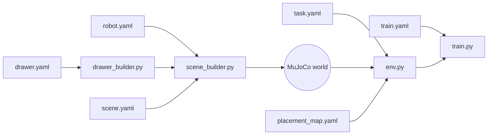

# `configs/`: every number the project uses

All the settings live here as YAML files: the robot, the drawer, the table, the task, the reward and the training.
**The Python code contains no hard-coded dimensions, gains or weights**: change a value here and the next run
uses it.

| File | What it defines | Read by |
|---|---|---|
| [`robot.yaml`](#robotyaml-the-arm) | The Kinova Gen3 Lite: model file, joints, gripper, tool tip, start pose | `drawer_rl/env.py`, `scene_builder.py` |
| [`drawer.yaml`](#draweryaml-the-cabinet-drawer-and-handle) | The cabinet, sliding drawer and handle, with friction | `drawer_rl/drawer_builder.py` |
| [`scene.yaml`](#sceneyaml-the-table-and-the-world) | The lab table, robot mount, drawer placement, physics, cameras | `drawer_rl/scene_builder.py`, `env.py` |
| [`task.yaml`](#taskyaml-the-rl-task) | Controller, episode rules, observations, **reward**, randomisation | `drawer_rl/env.py`, `controller.py`, `rewards.py` |
| [`train.yaml`](#trainyaml-the-learning-algorithm) | SAC/PPO/TD3 hyperparameters, parallelism, checkpoints | `scripts/train.py` |
| [`placement_map.yaml`](#placement_mapyaml-where-the-drawer-may-go) | Which drawer positions the arm can physically open (generated) | `drawer_rl/placement_map.py` |
| [`placement_map_v6.yaml`](#placement_map_v6yaml-the-map-for-the-older-policies) | The same map for the older setup, used to run the included v7 policy | `scripts/evaluate.py` (via `--set`) |
| [`vision/`](vision/README.md) | Camera, ArUco tags, vision pipeline, calibration | `drawer_vision/` |



---

## Conventions

* **Units:** metres, kilograms, seconds, radians (unless a key ends in `_deg`).
* **Robot base frame:** almost every position is measured from the centre of the bottom of the robot's base.
  **+x** points forward (towards the drawer), **+y** to the robot's left, **+z** up. This is the same frame the
  Kinova controller reports in, so numbers carry over to the real arm.
* **`(ASSUMED)`** in a comment means the value was estimated, not measured. Those are the first things to measure
  on the real hardware.

## Changing a value without editing the file

Every script accepts `--set file.key.subkey=value`. The value is parsed as YAML, so numbers, lists and `true`/`false`
work:

```bash
.venv/bin/python scripts/build_scene.py --view --set drawer.top_drawer.front_height=0.135
.venv/bin/python scripts/train.py --name test --set task.reward.weights.grasp=3.0 train.total_timesteps=200000
```

Each training run saves a frozen copy of all five files in `runs/<name>/configs/`, so a trained policy always knows
the exact world it was trained in, even after these files change.

---

## `robot.yaml`: the arm

Everything the code needs to know about the Kinova Gen3 Lite.

| Key | What it is |
|---|---|
| `mjcf_path` | The arm model file: `model/kinova_gen3_lite/gen3_lite.xml` |
| `base_body` | The model body that defines the robot base frame (`base_link`) |
| `arm_joints`, `arm_actuators` | Names of the 6 arm joints and their motors in the model |
| `gripper` | Gripper motor and joint names, the control values for fully open (`0.96`) and fully closed (`-0.09`), and which finger bodies count as "touching the handle" when detecting a grasp |
| `tcp` | The **tool centre point**, the spot between the finger pads that has to end up on the handle. It's the model's `ee_site` plus 8 mm forward. `approach_axis` / `finger_axis` say which way the gripper points and closes |
| `start_tcp_pos` | Where the gripper starts each episode, about 20 cm in front of the handle and level with it. The joint angles are found by inverse kinematics |
| `start_qpos_noise` | Random joint noise (rad) added at every reset, so the policy doesn't memorise one start |
| `ik_preferred_qpos` | When several arm postures reach the start position, pick the one closest to Kinova's factory "Home" pose |
| `joint_limits` | Extra joint limits; `null` uses the model's own |
| `actuator_overrides` | Changes to the model's motors. The gripper gets a lower damping (the original made it jam ~60 % open) and a grip-force limit of about 50 N (the original could squeeze ~1000 N and popped the handle out) |

**When to edit:** after measuring the real arm, e.g. its real grip force, or if you change where the robot starts.

---

## `drawer.yaml`: the cabinet, drawer and handle

The cabinet is **built from these numbers** by `drawer_rl/drawer_builder.py`; there is no separate drawer model
file. Values come from the measured *Drawer dimensions* PDF.

Its own frame: origin at the bottom-centre of the cabinet's front edge, +x into the cabinet. The drawer opens along −x.

| Section | Key values |
|---|---|
| `cabinet` | 34.5 × 39.5 × 49 cm (W × D × H), panel thicknesses, the 1.75 cm top-slab overhang, colour |
| `top_drawer` | The drawer that opens: front 14.5 cm high and 1.6 cm thick, box size, 1.5 kg mass |
| `top_drawer.slide` | **The slide physics, the most important values for sim-to-real.** `max_travel` 30 cm, `damping` 8 N·s/m, `frictionloss` 3 N (force to start it moving), and `side_load_friction` 0.25 (v8): pulling crooked adds 0.25 N of friction per N of sideways load, so wedging the handle jams the drawer like a real one |
| `handle` | 10.5 cm long bar, 3 cm out from the drawer front, 1.9 cm finger gap, 1.1 cm thick, centred on the front |
| `bottom_drawer` | A static lower drawer front (19 cm), for looks and collisions only |
| `physics` | Contact friction and softness for the cabinet's surfaces |

**When to edit:** after measuring the real drawer. Slide friction and damping are still `(ASSUMED)`. The top drawer's
front height is 14.5 cm on one page of the PDF and 13.5 cm on another, so it needs confirming.

---

## `scene.yaml`: the table and the world

| Section | What it is |
|---|---|
| `table` | **The measured lab table:** 1.205 × 1.36 m. `robot_offset_on_table` places the robot on it. `robot_mount_height` is the 5 cm mount the real robot stands on (v8). `max_cabinet_overhang` 0.12 lets the cabinet hang up to 12 cm over the table edge, because the real table is too shallow for it at the nominal distance; clamp or weigh down the real cabinet |
| `drawer_placement` | Where the cabinet stands, in the robot base frame: 0.60 m in front, **0.18 m to the robot's right** (straight ahead puts the wrist on a singularity), facing the robot |
| `physics` | 2 ms timestep, `implicitfast` integrator, **elliptic friction cone with `impratio` 50.** Without these, every grasp slipped off the fingertips |
| `cameras` | Fixed cameras for previews and videos (`overview`, `side_view`, `drawer_closeup`) |
| `render` | Image size and the free camera used for videos |

**When to edit:** if the table, robot mount or drawer position changes in the lab. After changing anything here,
**rebuild the placement map** (`scripts/check_reachability.py --map`), or training refuses to start.

---

## `task.yaml`: the RL task

The biggest file: it defines what the policy controls, what it sees, how it's scored and how each episode varies.

### `control`: how actions become motion

| Key | Meaning |
|---|---|
| `frequency_hz: 20` | The policy decides 20 times a second (every 50 ms) |
| `mode: ee_delta` | Actions move the gripper in Cartesian space; inverse kinematics finds the joint motion |
| `ee_max_step: 0.0125` | At most 1.25 cm per step = 0.25 m/s, the real Gen3 Lite's speed limit |
| `ee_rotation_actions: yaw` | The policy can also turn the gripper left/right (±30°, `ee_max_yaw_deg`), for rotated drawers |
| `actuation: velocity` | **v8:** the controller sends joint speeds, as on the real Kortex controller |
| `joint_max_accel` | **v8:** per-joint acceleration limits measured on the real arm (shoulder and elbow are slow: 0.5 and 0.4 rad/s²) |
| `velocity_kp`, `servo_max_lag` | How hard the controller corrects tracking error, and how far the motor target may run ahead |
| `gripper_max_speed: 0.47` | **v8:** the gripper takes 2.1 s to close, as measured on the real one |
| `workspace` | A box the gripper target may never leave |

### `episode`: the rules of one attempt

`max_steps` 300 (15 s). **Success** = drawer at least 15 cm open (`success_opening`) for 5 steps in a row, **while
grasping the handle** (`success_requires_grasp`). The episode doesn't end on success, so the policy learns to hold
the drawer open.

### `observation`: what the policy sees

`include` lists the 41 numbers, in order: joint angles and speeds, gripper opening, gripper position and
orientation, handle position, handle minus gripper, drawer direction, drawer opening, controller state, previous
action. `noise` adds realistic sensor and camera noise to each.

### `reward`: how each step is scored

`weights` sets the size of every reward and penalty term; the formulas are in
[`drawer_rl/rewards.py`](../drawer_rl/README.md#rewardspy).

| Rewards (+) | Penalties (−) |
|---|---|
| `reach` 1: gripper close to the handle | `collision` 2: arm touching cabinet or table |
| `align` 0.5: gripper pointing into the drawer | `finger_contact` 0.5: fingers touching anything but the handle |
| `grasp` 2: both fingers on the bar, gripper closed | `handle_side_force` 3: pushing the handle sideways |
| `open` 6: drawer open, while grasping | `torque_saturation` 2: joints near their torque limit |
| `open_progress` 30: progress towards 15 cm, while grasping | `drawer_speed` 5: yanking faster than 0.25 m/s |
| `success` 10: at 15 cm, while grasping | `off_axis`, `joint_limit`, `action`, `action_rate`, `joint_vel`: crooked, risky or jerky motion |

### `randomization`: what changes every episode

Randomisation stops the policy memorising one exact motion, and covers what isn't known exactly about the real world.

| Key | What varies |
|---|---|
| `drawer_offset_x/_y`, `drawer_z`, `drawer_yaw_range_deg` | Drawer distance (−6…+9 cm), sideways (±2 cm), height (±1 cm) and rotation (±15°). Distance and rotation are drawn **together from the placement map**, so only openable placements are used |
| `placement_map`, `placement_map_erode`, `validate_reachability` | Which map to use, a 1-cell safety margin around impossible placements, and a start-up check that the map matches the current settings |
| `slide_damping_scale`, `slide_friction_scale`, `handle_friction_scale` | Drawer and handle friction ×0.6–1.6 / ×0.8–1.2 |
| `actuator_kp_scale`, `gripper_force_scale` | Motor stiffness and grip force (real values not known exactly) |
| `initial_opening` | Drawer starts 0–1 cm open |
| `action_delay_steps` | Commands arrive 0–100 ms late |
| `handle_obs_bias_m` | A fixed handle-position error per episode, like an imperfect camera calibration |
| `vision_delay_steps`, `vision_dropout_*` | Camera measurements arrive late, and sometimes freeze for 2–6 steps (a tag hidden by the gripper) |

---

## `train.yaml`: the learning algorithm

| Key | Value | Meaning |
|---|---|---|
| `algorithm` | `SAC` | Soft Actor-Critic. `PPO` and `TD3` sections exist too |
| `total_timesteps` | 1,000,000 | Simulation steps to train for (~2 h on the laptop) |
| `n_envs` | 5 | Parallel simulations. More crashed the laptop (out of memory) |
| `normalize_obs` | `true` | Rescale every input to a similar range (saved as `vecnormalize.pkl`) |
| `eval_every` / `eval_episodes` | 20k / 10 | Test without exploration every 20k steps; the best result is saved as `best/best_model.zip` |
| `checkpoint_every` | 100k | Save everything, for `--resume` after a crash |
| `SAC.buffer_size` | 300k | Replay memory of past steps |
| `SAC.batch_size`, `gradient_steps` | 512, 3 | Each update learns from 512 random past steps; 3 updates per round |
| `SAC.gamma` | 0.99 | How far ahead it plans (~5 s) |
| `SAC.policy_kwargs.net_arch` | `[256, 256, 256]` | The neural network: three hidden layers of 256 |
| `env_configs` | | Which robot/drawer/scene/task files to train with |

---

## `placement_map.yaml`: where the drawer may go

> [!IMPORTANT]
> Generated by `scripts/check_reachability.py --map`. Don't edit it by hand.

A grid of drawer **distance offsets** (`xs`, metres from the nominal placement) × **rotations** (`yaws_deg`).
`feasible` holds 1 where the arm can physically open the drawer:
- inverse kinematics along the whole pull, with margin to the joint limits;
- no singularity and no collisions;
- the cabinet fits on the table;
- a scripted grasp-and-pull succeeds in full physics.

`min_joint_margin_deg` records how close to its limits the arm gets in each cell.

The `fingerprint` section stores the settings the map was built for. If any of them change (table, mount, drawer
placement, start pose, speed limits, gripper speed, …), the environment **refuses to start** until the map is
rebuilt, so training can never use placements that are impossible in the current setup.

## `placement_map_v6.yaml`: the map for the older policies

The placement map from the v6/v7 setup: old 1.4 × 1.0 m table, drawer straight ahead, no robot mount. It's kept
so the included v7 policy (`runs/sac_audit_fix_v7/`) can run in the world it was trained in:

```bash
.venv/bin/python scripts/evaluate.py runs/sac_audit_fix_v7 --which best --viewer \
  --set task.randomization.placement_map=configs/placement_map_v6.yaml task.randomization.validate_reachability=false
```

Its fingerprint predates some of the newer keys, so the start-up check has to be switched off
(`validate_reachability=false`) when using it.
