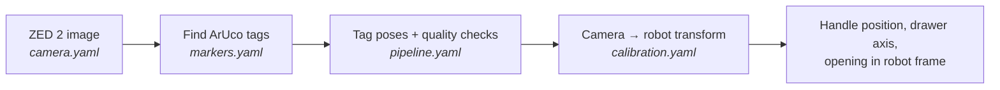

# `configs/vision/`: camera and tag settings

Settings for the real-world vision pipeline: a **ZED 2 stereo camera** watches **ArUco tags** on the drawer and
reports where the handle is, which way the drawer opens and how far it's open, in the robot's coordinate frame.
These are the same three drawer quantities the policy gets from the simulator during training.

| File | What it defines |
|---|---|
| [`camera.yaml`](#camerayaml-which-camera-and-how) | Which camera source to use and its settings |
| [`markers.yaml`](#markersyaml-the-aruco-tags) | Which tags exist, their sizes and where each one is stuck |
| [`pipeline.yaml`](#pipelineyaml-how-images-become-drawer-state) | Pose solving, quality checks, smoothing, opening measurement |
| [`calibration.yaml`](#calibrationyaml-calibration-procedures) | Calibration board, camera-to-robot calibration method, robot connection |

The drawer's dimensions are **not** repeated here: the pipeline reads them from [`../drawer.yaml`](../README.md),
so the simulation and the real pipeline always agree on where the handle is relative to the tags.

> [!NOTE]
> These settings are used by the `drawer_vision` package and the `scripts/vision/` tools. Everything can be tried
> without hardware by running against a simulated ZED (`--source mujoco`).

---

## `camera.yaml`: which camera, and how

`source` picks the camera. Each source has its own block of settings:

| `source` | What it is | Key settings |
|---|---|---|
| `zed` *(default)* | The ZED 2 through Stereolabs' SDK. Gives rectified images, factory calibration **and depth** | `resolution` (HD1080: a 7 cm tag 1 m away is ~54 px wide), `fps`, `depth_mode` (`NEURAL`), depth range, optional `svo_file` to play back a recording |
| `uvc` | The ZED 2 as a plain USB webcam (no SDK, no depth). It sends both lenses side by side; the left half is used | `device`, frame size, `intrinsics_file` from `calibrate_intrinsics.py`, or the ZED factory file via `zed_conf_file` |
| `replay` | Frames recorded earlier with `scripts/vision/record.py` | `path`, `loop`, `fps` |
| `mujoco` | A **virtual ZED inside the simulation**, with the tags modelled as real geometry. For testing everything without hardware | Resolution, field of view (70°, like the ZED 2), camera position and look-at point in the robot frame, pixel noise |

Any script can switch source without editing the file: `--source mujoco`.

---

## `markers.yaml`: the ArUco tags

Print the tags with `scripts/vision/generate_markers.py`. **`size` is the side of the black square in metres: measure
the printout with a ruler** and correct it here if it differs, because every distance the camera measures scales with it.

| Section | Tags | Purpose |
|---|---|---|
| `dictionary`, `detector` | `DICT_4X4_50` | Tag family and detection settings (sub-pixel corner refinement) |
| `drawer` *(required)* | IDs **0** and **2**, 7 cm | On the moving drawer front, 11.5 cm left and right of the handle. The handle sticks out 3 cm and hides the far tag from an angle, and the gripper covers one while grasping, so with one tag each side one is always visible. All visible drawer tags are combined |
| `cabinet` *(optional, off)* | ID **1**, 5 cm | On top of the cabinet. Lets the opening be measured as drawer-vs-cabinet, which keeps working if the cabinet is bumped |
| `base_markers` | ID **10**, 10 cm | At a measured spot on the table, in the robot frame. Used by the `base_markers` calibration and optionally for live re-calibration |
| `gripper_marker` | ID **20**, 4 cm | Stuck on the gripper for hand-eye calibration. Its exact position on the gripper is solved by the calibration, so it doesn't need measuring |

Positions are given in a named frame (`drawer_front`, `cabinet` or `base`) with an `orientation` preset
(`facing_out`: on a vertical front face; `facing_up`: lying flat) or explicit `rpy_deg`.

---

## `pipeline.yaml`: how images become drawer state

| Section | What it controls |
|---|---|
| `calibration_dir`, `extrinsics_file`, `scene_state_file` | Where calibration results are saved (`calibration/`) |
| `extrinsics_mode` | `fixed`: use the saved camera-to-robot calibration. `live_base_marker`: re-estimate it every frame from the table tag when visible, which survives the camera stand being bumped |
| `pose` | Tag pose solver (`IPPE_SQUARE`, which returns both possible solutions of a flat tag), how to pick between them, and depth refinement: the ZED depth map corrects each tag's distance, which a single image measures poorly |
| `quality` | Detections are **dropped** if they fit badly (> 2 px error), are too small (< 25 px), are viewed too obliquely (> 70°) or are too far (> 3 m) |
| `filter` | Smoothing over time (`ema`), outlier rejection (jumps > 5 cm ignored unless they persist 3 frames), and marking the state invalid after 0.5 s without a good detection |
| `opening` | How the opening is measured: relative to the cabinet tag, relative to the closed position recorded by `setup_scene.py`, or `auto` (cabinet tag if visible) |
| `display` | What the live view draws |

---

## `calibration.yaml`: calibration procedures

| Section | What it controls |
|---|---|
| `charuco` | The checkerboard-with-tags board used for **lens (intrinsic) calibration**: 7 × 5 squares of 3.5 cm. It uses a different tag family so it never clashes with the scene tags. Only needed for the `uvc` source |
| `extrinsics` | **Where the camera is relative to the robot.** Default method `hand_eye` (tag on the gripper, ~12+ arm poses, ~1–3 mm), or `base_markers` (tags at measured table spots, ~5 mm), or `touch_points` (touch tag centres with the gripper tip). Frames averaged per sample, solver choice and the largest acceptable error |
| `robot` | How calibration reads the gripper pose: `kortex` (Kinova API at `192.168.1.10`) or `manual` (type it in from the Kinova Web App). **The username and password are read from the environment variables `KINOVA_USERNAME` / `KINOVA_PASSWORD`, never stored in this file.** `tool_to_tcp` maps Kinova's tool frame to the policy's tool tip |
