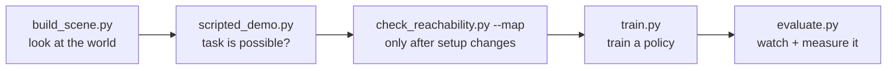

# `scripts/`: command-line tools

The entry points of the project: build and look at the world, train a policy, and watch or measure a trained one.

> [!TIP]
> Full commands and every option for each script are in **[Running_scripts.md](Running_scripts.md)**.

Run everything from the project root with the project's Python, e.g.:

```bash
.venv/bin/python scripts/scripted_demo.py --viewer
```

## At a glance

| Script | What it's for | Typical command |
|---|---|---|
| [`build_scene.py`](#build_scenepy) | Look at the simulated world | `scripts/build_scene.py --view` |
| [`scripted_demo.py`](#scripted_demopy) | Watch a hand-written grasp-and-pull (no AI) | `scripts/scripted_demo.py --viewer` |
| [`check_reachability.py`](#check_reachabilitypy) | Rebuild the placement map after a setup change | `scripts/check_reachability.py --map` |
| [`train.py`](#trainpy) | Train a policy | `scripts/train.py --name my_run` |
| [`evaluate.py`](#evaluatepy) | Run a trained policy, watch it, count successes | `scripts/evaluate.py runs/<run> --which best --viewer` |
| [`Running_scripts.md`](Running_scripts.md) | Detailed usage of every script | |



Every script accepts `--set key=value` to change any config value for one run, and `--help` to list its options.

---

## `build_scene.py`

Builds the world (table, robot mount, Gen3 Lite, cabinet) from `configs/` and either shows it or saves it.

* `--view` opens the **interactive MuJoCo viewer**. You can grab the drawer with the mouse and pull it.
* Without `--view` it writes `generated/scene.xml` (the whole world in one file) and preview pictures
  (`generated/preview_overview.png`, `preview_side_view.png`, `preview_drawer_closeup.png`).
* `--set ...` shows the world with a changed setting, e.g. `--set drawer.top_drawer.front_height=0.135`.

**Use it** to check that a config change looks right before training.

## `scripted_demo.py`

Runs the hand-written controller from [`drawer_rl/scripted.py`](../drawer_rl/README.md#scriptedpy): approach,
insert, grasp, pull, hold. There's no neural network involved. It prints the phase, grasp state and drawer opening
every 10 steps, then the final result.

* `--viewer`: watch it live in 3D, in real time. The window stays open at the end until you close it.
* `--video file.mp4`: save a video instead.
* `--offset 0.08 0 0`: move the drawer (x y z in metres); `--seed N`: a different random setup.

**Use it** as a physics sanity check. If this succeeds, the simulation allows the task, so a policy that fails has
a learning problem, not a broken world.

## `check_reachability.py`

Finds where the drawer can be placed so the arm can still **physically** open it, using
[`drawer_rl/reachability.py`](../drawer_rl/README.md#reachabilitypy): inverse kinematics along the whole pull,
joint-limit margins, singularities, collisions, table fit, and a real simulated pull.

* `--map` **rebuilds `configs/placement_map.yaml`** (distance × rotation grid). Required after changing the table,
  mount, drawer, start pose or controller limits, or training refuses to start. Slow: every cell gets a physics test.
* Without `--map`: sweeps distance only and plots the feasible band.
* `--verify-range XMIN XMAX`: checks a planned training range.

## `train.py`

**Trains a policy** with Stable-Baselines3 (SAC by default, settings from `configs/train.yaml`) in 5 parallel
copies of the environment.

```bash
.venv/bin/python scripts/train.py --name sac_real_v8
```

It writes `runs/<name>/`:
* `best/best_model.zip` + `best/vecnormalize.pkl`: the best policy found, tested every 20k steps;
* `final_model.zip`, `replay_buffer.pkl`, `vecnormalize.pkl`: the state at the end;
* `checkpoints/` every 100k steps, `tb/` TensorBoard logs, `eval/` test results;
* `configs/`: a frozen copy of every config.

| Option | What it does |
|---|---|
| `--resume runs/X` | Continue a stopped or crashed run |
| `--init-from runs/X` | Start from another run's weights (only if inputs and actions are unchanged) |
| `--set train.seed=1` | Another seed, to check the result repeats |

Ctrl+C or `kill <pid>` stops it **and saves**. Watch progress with `.venv/bin/tensorboard --logdir runs`.

## `evaluate.py`

**Runs a trained policy** on the simulated robot. It rebuilds the exact world the run was trained in (from
`runs/<run>/configs/`), loads the model and its input scaling, and lets the network control the arm. It prints success
and opening per episode, then the success rate.

* `--which best` / `final`: which saved model to load;
* `--viewer`: watch it live in 3D;
* `--video file.mp4`: save the first 3 episodes;
* `--episodes N`, `--stochastic`, `--set ...`.

The included v7 policy runs in its older world, so it needs two overrides:

```bash
.venv/bin/python scripts/evaluate.py runs/sac_audit_fix_v7 --which best --viewer \
  --set task.randomization.placement_map=configs/placement_map_v6.yaml task.randomization.validate_reachability=false
```

`evaluate.py` imports the algorithm list from `train.py`, so the two files belong together.

## `Running_scripts.md`

The detailed usage guide: every command, every option and the typical order of use.
